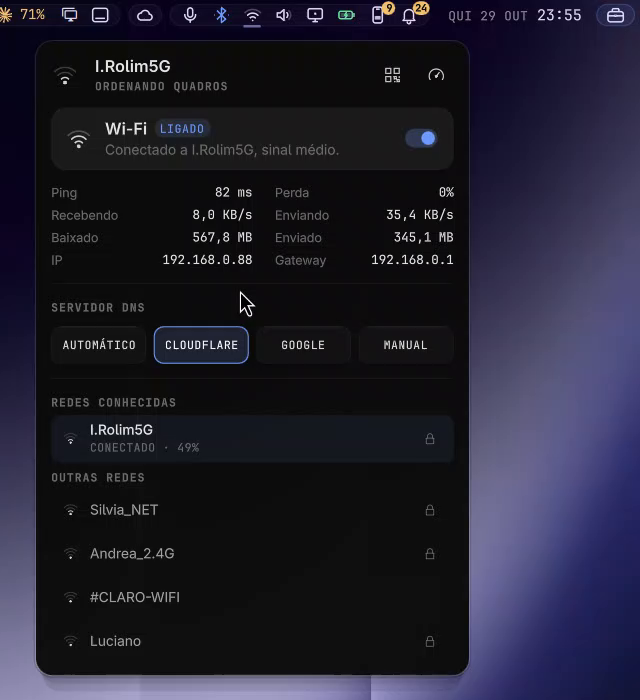

<div align="center">

# Island Network

**Omarchy's Network panel, in the Island look.**
Wi‑Fi list, connection state, DNS provider and Wi‑Fi band, drawn with thin stroke icons and a dark anatomy panel that opens right under its icon.



</div>

## Why this one

- ✏️ **The Island look.** Same stroke icons as [Island Bar](https://github.com/hugorolimf/omarchy-bar),
  colour only when it means something, one easing curve for every transition.
- 🧭 **Opens under its icon**, with the keyboard: Esc closes, Tab moves to the next panel.
- 🌍 **English or Portuguese**, following your system language.
- 🔒 **Enterprise Wi‑Fi that checks the server.** For WPA‑Enterprise (PEAP) it asks for
  the server's domain (filled in from your identity) and only connects when the server's
  certificate is signed by a system CA and matches it, so a fake access point can't
  collect your login. A saved profile without those checks asks for them before it
  reconnects, then gets replaced. Networks behind a private CA: import its certificate with
  `nm-connection-editor`. See [Enterprise Wi‑Fi profiles](#enterprise-wi-fi-profiles)
  for what it changes in NetworkManager.
- 🔄 **Drop-in.** It's Omarchy's own `omarchy.network` underneath (same behaviour, same
  shortcuts and IPC): enabling it takes the original's place on the bar.

## See it

Recorded on a real desktop, mouse included. The panel follows the system language;
this take is in Portuguese.

**Connection, live traffic, DNS and the networks around**, opened from the bar.


## Requirements

[Island Kit](https://github.com/hugorolimf/omarchy-island-kit): the panel is drawn with it.
Install the Kit first, or install this panel from the Kit's catalog.
Without the Kit, the plugin shows an "Install Island Kit" button on the bar
(in Portuguese, "Instale o Island Kit"); clicking it installs the Kit and
restarts the shell.

## Install

```bash
omarchy plugin add https://github.com/hugorolimf/omarchy-island-kit --enable
omarchy plugin add https://github.com/hugorolimf/omarchy-island-network --enable
```

## Enterprise Wi‑Fi profiles

Everything the panel does to NetworkManager profiles, all of it on enterprise
(802.1X) Wi‑Fi:

- **Reconnecting from the panel** first checks the network's saved profiles. A saved
  802.1X profile without a CA and a server domain is never started from the panel: on
  WPA/WPA2‑Enterprise it asks for the server and, once that connects, deletes the
  profiles it replaces (the SSID's 802.1X profiles that don't check the server; others
  stay). If the new one doesn't connect, it is removed and the old ones stay as they were.
- **Profiles saved by the earlier setup** (this plugin before 1.0.2, and Omarchy's own
  network panel) check no server: PEAP/MSCHAPv2, auth timeout 8 s, named after the
  SSID, no CA, no domain. NetworkManager would auto-connect them on its own, so when
  the plugin loads it turns their auto-connect off (`connection.autoconnect no`) and, if
  one is connected at that moment, disconnects it, then says so in a notification. That
  setting is the only change; the profile and its password stay. Profiles of any other
  shape are left alone.
- To undo it for a network you trust as it is:
  `nmcli connection modify "<network>" connection.autoconnect yes`.

## Remove

```bash
omarchy plugin remove io.github.hugorolimf.network
```

Omarchy's own network panel comes back to the bar.

## Credits

A clone of Omarchy's `omarchy.network` panel by David Heinemeier Hansson and the
[Omarchy](https://github.com/basecamp/omarchy) contributors (MIT); the look, icons and the
Portuguese wording are this plugin's.

## The other Island panels

[Island Sound](https://github.com/hugorolimf/omarchy-island-audio) · [Island Bluetooth](https://github.com/hugorolimf/omarchy-island-bluetooth) · [Island Network](https://github.com/hugorolimf/omarchy-island-network) · [Island Power](https://github.com/hugorolimf/omarchy-island-power) · [Island Display](https://github.com/hugorolimf/omarchy-island-display) · [Island Weather](https://github.com/hugorolimf/omarchy-island-weather)

## License

[MIT](LICENSE)
